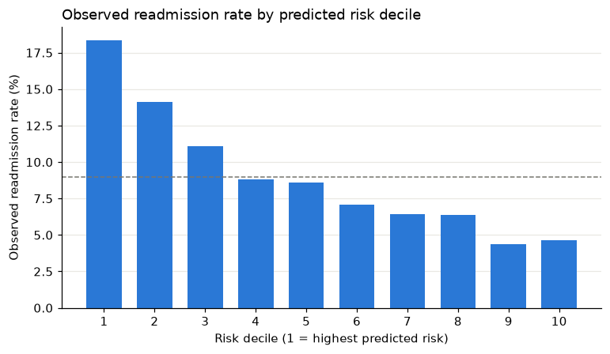

# Hospital readmission risk for patients with diabetes

Predicting which patients with diabetes will be back in hospital within 30 days of discharge, and using the prediction to target follow-up care.

**[Open the Streamlit app](https://hospital-readmission-risk-nt9xdae5elppevxlcnwqef.streamlit.app/)** · **[Open the web dashboard](https://chiamaka-uchenna.github.io/hospital-readmission-risk/)** · **[Read the notebook](notebooks/hospital_readmission.ipynb)**



## The problem

Unplanned readmissions harm patients and cost health systems heavily. About one in five US Medicare patients is readmitted within 30 days (Jencks et al., NEJM 2009), and US hospitals with excess readmissions are penalised under the Hospital Readmissions Reduction Program. Follow-up care reduces readmissions but is expensive, so it has to be aimed at the patients most at risk.

## Data

[Diabetes 130-US Hospitals, 1999 to 2008](https://archive.ics.uci.edu/dataset/296/diabetes+130-us+hospitals+for+years+1999-2008) (UCI Machine Learning Repository, CC BY 4.0). 101,766 real, de-identified inpatient encounters from 130 US hospitals.

The notebook downloads the data itself the first time it runs and caches it in `data/raw/`, so nothing needs to be downloaded by hand.

## Key results

- After removing deaths, hospice discharges and repeat encounters, 69,987 patients remain. 9.0% were readmitted within 30 days.
- Gradient boosted model: AUROC 0.639 on a held-out test set (95% interval 0.62 to 0.65), against 0.634 for logistic regression. That is in the range of clinical scores in routine use such as LACE, and the probabilities are well calibrated.
- The highest-risk tenth of patients is readmitted at 18.4%, twice the average. The top three tenths contain 48% of all readmissions.
- Under stated cost assumptions, offering a follow-up programme to the highest-risk 27% of patients saves about $585,000 across 13,998 test patients. Offering it to everyone loses about $428,000.
- Fairness audit: ranking quality is similar across sex, age and race. The model slightly under-predicts for African American and Hispanic patients, which is flagged for monitoring.

## Approach

1. Cleaning with a stated reason for each rule, including keeping one encounter per patient to prevent leakage
2. Feature engineering from ICD-9 codes, discharge codes and 23 medication columns
3. Logistic regression baseline and XGBoost with early stopping, 60/20/20 split
4. Discrimination (AUROC, average precision), calibration, decile lift, bootstrap confidence intervals
5. A cost model for targeting, SHAP explanations and a subgroup audit

Every step is explained in the notebook, with the reasoning behind each decision.

## Live dashboard

The dashboard is a static page served by GitHub Pages from the `docs/` folder. The trained model is exported from the notebook as JSON and scored in the browser with a few lines of JavaScript, so there is no server to maintain. The notebook checks that the exported model reproduces the original predictions before writing the file.

## Streamlit app

The same model and charts are deployed as a Streamlit app on Streamlit Community Cloud: [https://hospital-readmission-risk-nt9xdae5elppevxlcnwqef.streamlit.app/](https://hospital-readmission-risk-nt9xdae5elppevxlcnwqef.streamlit.app/). If the app has been idle it takes a few seconds to wake up. The code is in `app/`. To run it locally:

```bash
pip install -r app/requirements.txt
streamlit run app/streamlit_app.py
```

`app/common.py` contains the scoring code: it loads the exported trees and reproduces the model's predictions in plain Python.

## Repository layout

```
notebooks/hospital_readmission.ipynb   the full analysis, with outputs
scripts/hospital_readmission.py   the same pipeline as a plain Python script
app/                        Streamlit app (streamlit_app.py, common.py, requirements.txt)
docs/                       the static dashboard served by GitHub Pages
data/                       raw data is downloaded here by the notebook (not committed)
requirements.txt            Python dependencies for the notebook
```

## Run it yourself

```bash
git clone https://github.com/Chiamaka-Uchenna/hospital-readmission-risk.git
cd hospital-readmission-risk
python -m venv .venv
source .venv/bin/activate        # on Windows: .venv\Scripts\activate
pip install -r requirements.txt
jupyter notebook notebooks/hospital_readmission.ipynb
```

Running the notebook from top to bottom regenerates every figure and rewrites the files in `docs/data/` that the dashboard reads. To view the dashboard locally:

```bash
python -m http.server 8000 --directory docs
```

## Limitations

The data is from 1999 to 2008 and from the US. Social factors that drive readmission are not recorded. This is a research demonstration and not a clinical tool.

## Author

Chiamaka Uchenna

Code is released under the MIT licence. The data belongs to its publishers and is used under the licences noted above.
